# nglib

`nglib` is a small R package of **ggplot2 themes, color scales and quick
exploratory data analysis (EDA) plots**, plus a few small data-wrangling
helpers.

What's included:

| Area | Functions |
|---|---|
| Themes | `theme_quant()`, `theme_poster()`, `set_theme_quant()`, `set_theme_poster()`, `update_font_defaults()` |
| Scales | `scale_color_quant()`, `scale_fill_quant()`, `scale_color_quant_manual()`, `scale_fill_quant_manual()` |
| Palettes | `get_palettes()`, `quant_pal()`, `plot_colors()`, `test_pal()`, `convert_mm_to_pts()` |
| EDA: univariate | `eda_plot_histograms()`, `eda_plot_column()`, `eda_plot_missing_counts()`, `eda_plot_missing_values()`, `eda_plot_normal_qq()`, `eda_plot_category_dominance()` |
| EDA: bivariate | `eda_plot_scatter()`, `eda_plot_box()`, `eda_plot_bar()`, `eda_plot_density()`, `eda_plot_stacked_bar()`, `eda_plot_transforms()` |
| EDA: multivariate | `eda_plot_scatter_cat()`, `eda_plot_scatter_cat_facets()`, `eda_plot_heatmap()`, `eda_plot_correlation_matrix()`, `plot_correlations_gg()`, `eda_plot_association_matrix()`, `eda_plot_target_correlations()`, `eda_plot_box_by_bins()` |
| EDA: model fit | `eda_plot_actual_vs_predicted()` |
| Data helpers | `find_mode()`, `%notin%`, `change_na_to()`, `change_na_to_most_common_value()`, `median_by_grouping()`, `most_common_value_by_grouping()`, `significant_digits()`, `pct_diff_lagging()`, `pct_diff_leading()`, `nearest_multiple()`, `correlation_reorder_matrix()`, `association_matrix()`, `flag_outliers()` |

## Installation

From GitHub:

```r
# install.packages("remotes")
remotes::install_github("nitingupta2/nglib")
```

Or from a local clone:

```r
install.packages("path/to/nglib", repos = NULL, type = "source")
```

## Interactive use

`nglib` is built for interactive analysis. Loading it
attaches `tidyverse`, `ggplot2`, `dplyr`, `tidyr`, `purrr`, `forcats`,
`magrittr`, `scales`, `glue`, `rlang` and `ggridges`, so pipelines and
`ggplot()` work straight after `library(nglib)`. The cost is a busier search
path (e.g. `filter()` and `lag()` are masked) and a slower startup.

## Fonts

`theme_quant()` defaults to **Roboto Condensed** and `theme_poster()` to
**Inter**. Both are free on [Google Fonts](https://fonts.google.com/). If a
font isn't installed, either install it or pass `font_family = ""` to use the
device's default font. On Windows, the font is found most reliably when
plots are rendered with [ragg](https://ragg.r-lib.org/): set
*Tools > Global Options > Graphics > Backend: AGG* in RStudio, or pass
`device = ragg::agg_png` to `ggsave()`.

## Usage

```r
library(nglib)
set_theme_quant()   # theme_quant() for all plots, with matching geom_text fonts

eda_plot_histograms(mtcars, c("mpg", "wt", "disp", "hp"))
```

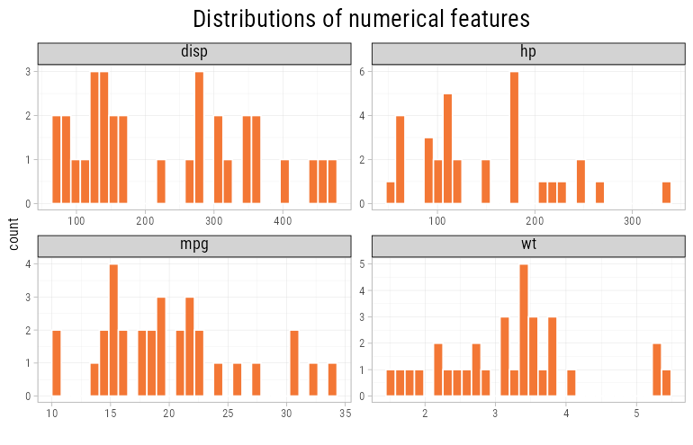

Categories are ordered by the median of the numerical feature, unless they are
an ordered factor:

```r
eda_plot_box(ggplot2::mpg, "class", "hwy")
```

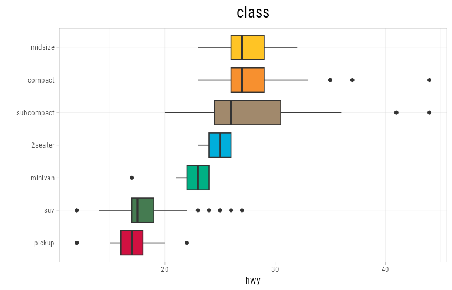

```r
eda_plot_density(ggplot2::diamonds, "cut", "price", xLog = TRUE,
                 xLabelsScale = scales::label_dollar())
```

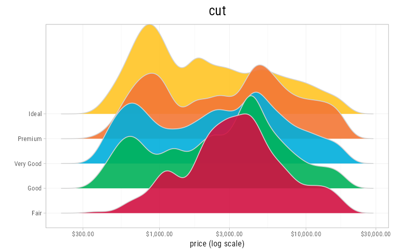

```r
eda_plot_scatter_cat_facets(ggplot2::mpg, "displ", "hwy", "drv")
```

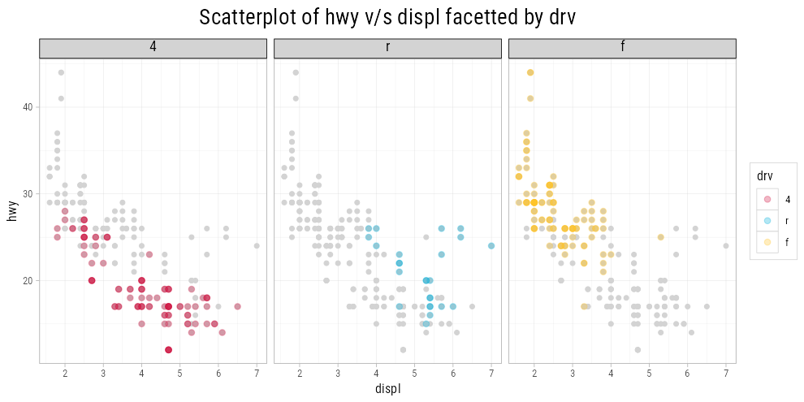

```r
eda_plot_heatmap(ggplot2::diamonds, "cut", "color", "price")
```

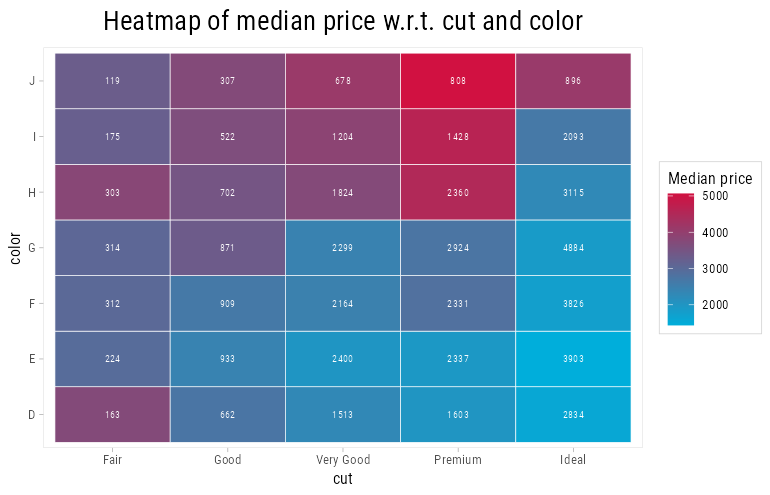

```r
eda_plot_correlation_matrix(mtcars, outlineVar = "mpg")
```

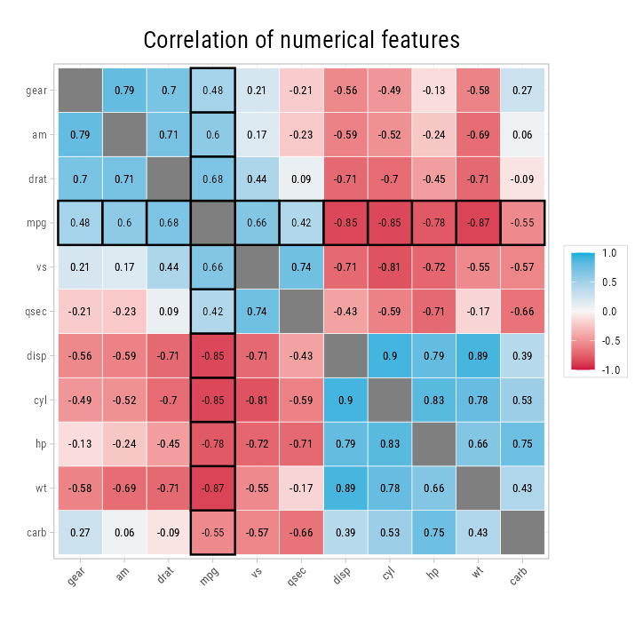

To include categorical features, use the association matrix: correlation
for numerical pairs, Cramer's V for categorical pairs and the correlation
ratio for mixed pairs. Clustering puts redundant features next to each
other, whatever their type:

```r
eda_plot_association_matrix(ggplot2::mpg, outlineVar = "hwy")
```

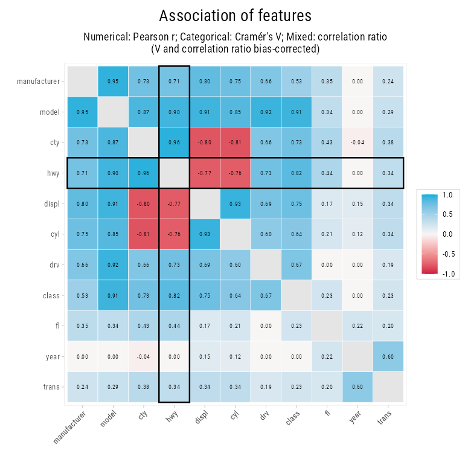

```r
eda_plot_missing_counts(airquality)
```

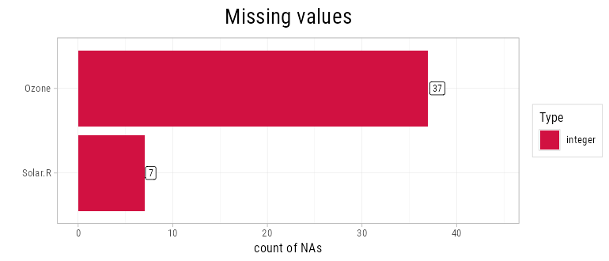

When there are too many features for a correlation matrix, plot only their
correlation with the target:

```r
eda_plot_target_correlations(mtcars, "mpg")
```

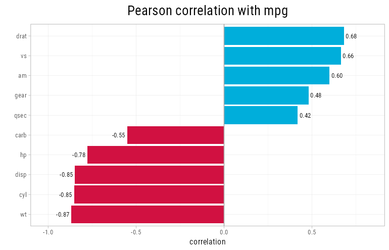

A category can look backwards when a numerical feature drives both it and
the target. Better clarity diamonds have a lower median price only because
they tend to be smaller; within bins of carat, price rises with clarity:

```r
eda_plot_box_by_bins(ggplot2::diamonds, "clarity", "price", "carat", yLog = TRUE)
```

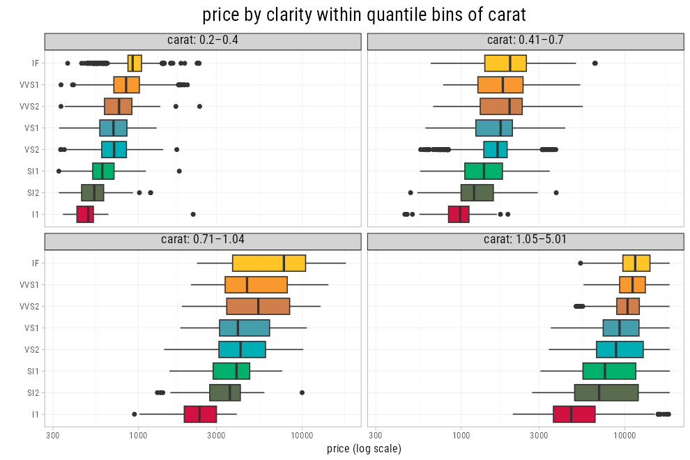

To pick a transform, compare how linear each one is with the target:

```r
eda_plot_transforms(ggplot2::diamonds, "carat", "price")
```

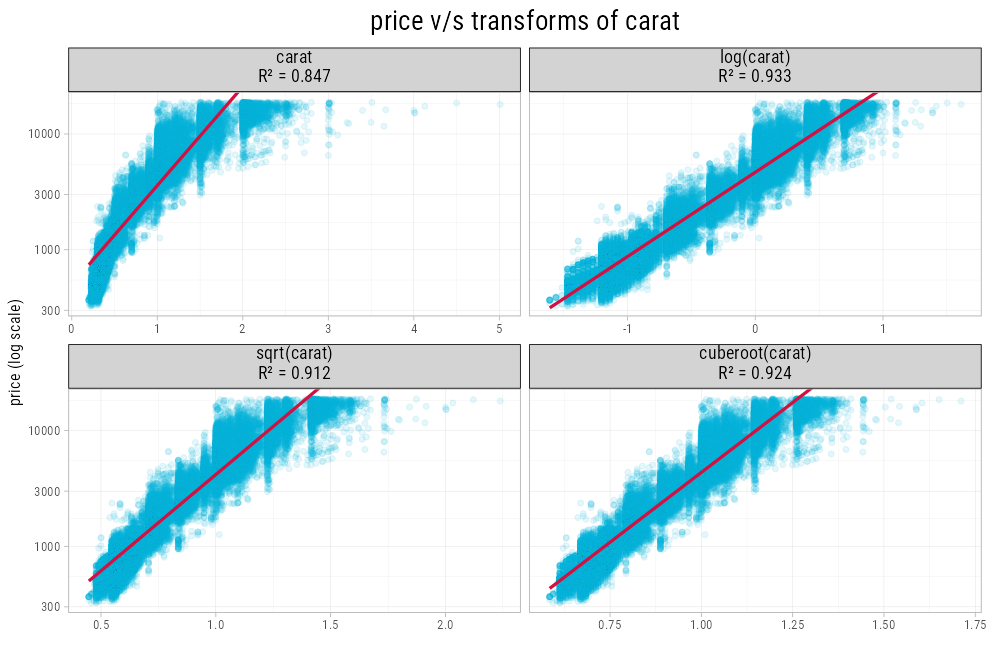

To find near-constant categorical features and rare levels:

```r
eda_plot_category_dominance(ggplot2::mpg, threshold = 0.6)
```

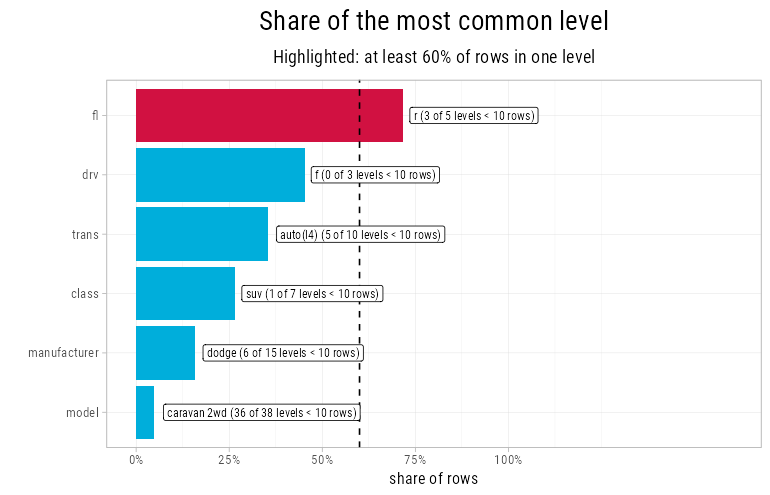

To label the points that pull a linear fit the most, such as a few very
large houses sold cheaply, use `nLabel`; `flag_outliers()` flags values far
from the median:

```r
cars <- tibble::rownames_to_column(mtcars, "car")
eda_plot_scatter(cars, "hp", "mpg", nLabel = 3, feature_id = "car")
cars[flag_outliers(cars$hp), "car"]
```

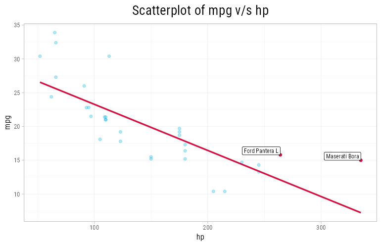

To check a model's predictions, with the worst ones labelled:

```r
fit <- lm(mpg ~ wt + hp, data = mtcars)
df <- data.frame(car = rownames(mtcars), mpg = mtcars$mpg, pred = fitted(fit))
eda_plot_actual_vs_predicted(df, "mpg", "pred", feature_id = "car", nLabel = 3)
```

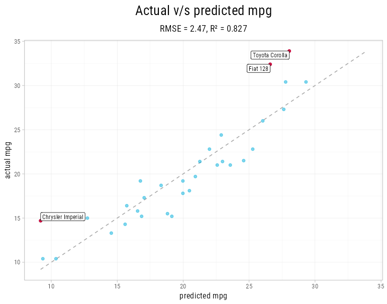

### Themes and scales

The scales work in any ggplot. `discrete = FALSE` turns a palette into a
continuous gradient:

```r
ggplot(ggplot2::economics_long, aes(date, value01, color = variable)) +
    geom_line(linewidth = 1) +
    scale_color_quant(palette = "metro") +
    theme_poster()
```

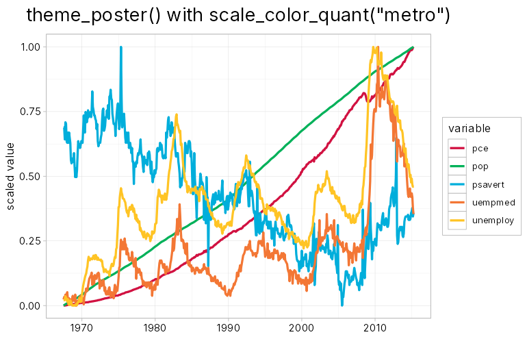

The palettes are `main`, `withgrey`, `pnl`, `weights`, `metro`, `greyscale`
and `heatmap`. To preview one, run `test_pal("metro")`; to get its hex codes,
run `plot_colors("metro", n = 5)`.

## License

MIT © Nitin Gupta
